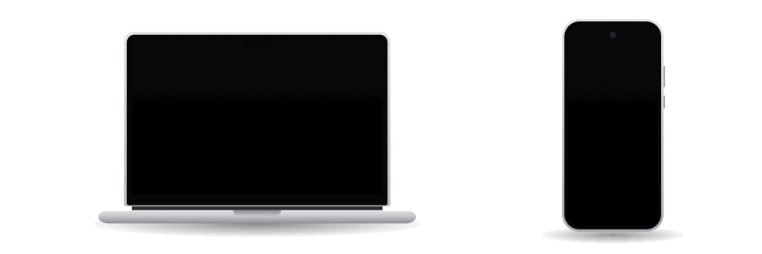
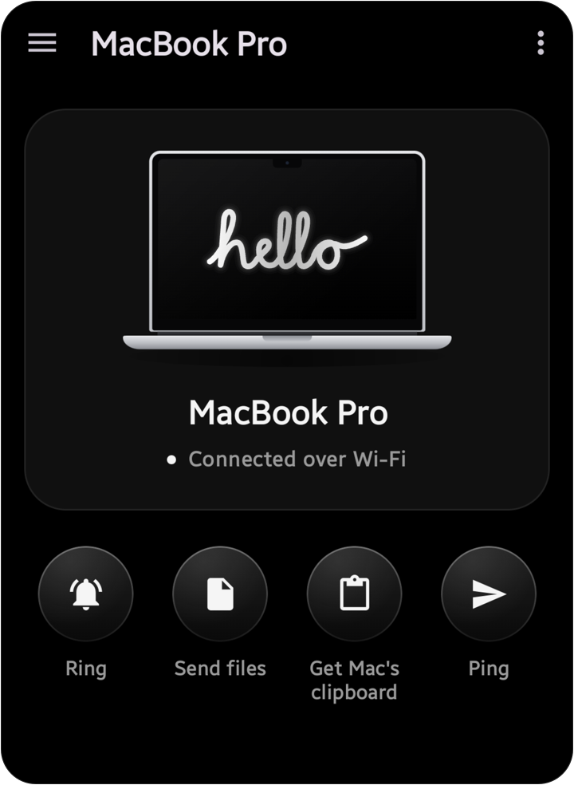

<p align="center">
  <picture>
    <source media="(prefers-color-scheme: dark)" srcset="assets/greeting-dark.gif">
    
  </picture>
</p>

<p align="center">
  <a href="https://github.com/atikulmunna/GlassLink/releases/latest"></a>
  
  <a href="LICENSE"></a>
</p>

GlassLink brings your Android phone to your Mac: mirror and control its screen, answer
notifications, text, and share your clipboard, screenshots and files. Native on both sides, local
Wi-Fi only, no accounts.

<p align="center">
  <a href="https://github.com/atikulmunna/GlassLink/releases/latest"><b>Download for Mac (.dmg)</b></a>
  &nbsp;·&nbsp;
  <a href="https://github.com/atikulmunna/GlassLink/releases/latest"><b>Download for Android (.apk)</b></a>
</p>

<p align="center">
  
  &nbsp;
  
</p>

## Why GlassLink

Phone Link only runs on Windows, and Apple's Continuity only works with iPhone. KDE Connect works on
a Mac, but as an experimental Qt app without screen mirroring, image copy and paste, or screenshot
sync. GlassLink is a native SwiftUI app for Mac plus a KDE Connect fork for Android that adds all
three. It still speaks the KDE Connect protocol, so the Mac app also works with stock KDE Connect.

<p align="center">
  <picture>
    <source media="(prefers-color-scheme: dark)" srcset="assets/comparison-dark.svg">
    
  </picture>
</p>

## Features

- **Phone Screen:** mirror the whole screen or one app (**⇧⌘M**). Click, drag, scroll and type to
  use it; right-click or **Esc** goes Back.
- **Notifications** with inline reply and actions, in Notification Center.
- **Messages:** your SMS conversations, with replies from the Mac.
- **Calls:** answer, decline or silence from the Mac (you talk on the phone), and missed-call alerts.
- **Clipboard:** text and images, both ways.
- **Screenshots:** on the other device's clipboard within a second, never saved as files.
- **Files:** drag onto the window to send.
- **Find my phone,** battery and signal, and a menu bar panel.
- **Disconnect** from the phone's notification or the power button in its app; it stays off until
  you reconnect.
- **Updates in the apps:** both check GitHub once a day (or on demand) and install new versions
  for you.

<p align="center">
  
  
</p>

## Install

**Mac** (macOS 26 or later): download the `.dmg` from the
[latest release](https://github.com/atikulmunna/GlassLink/releases/latest) and drag GlassLink to
Applications. It isn't notarized yet, so on first launch click **Done**, then **Open Anyway** in
**System Settings › Privacy & Security**. Allow local network access when asked.

**Android** (6.0 or later):

1. Install the `.apk` from the [latest release](https://github.com/atikulmunna/GlassLink/releases/latest).
   Disable KDE Connect first if you have it; both use the same port.
2. On the same Wi-Fi, pair from either device and check that both show the same code.
3. Grant the permissions you want under **Finish setting up**.
4. To control the phone while mirroring, turn on GlassLink in **Settings › Accessibility**. If it's
   marked restricted, go to **Settings › Apps › GlassLink › ⋮ › Allow restricted settings** first.
   Typing from the Mac needs Android 14 or later.

**Verify:** files are listed in `SHA256SUMS`. The APK's signing certificate SHA-256 is:

```
18:8E:28:A2:8D:20:85:E6:29:B4:5E:64:B2:F3:63:CC:3D:04:D1:50:F9:24:5C:F9:01:83:AD:82:D4:C5:CA:03
```

**Optional, automatic phone-to-Mac clipboard.** Android blocks background clipboard reads. With USB
debugging on, run this once:

```sh
adb shell pm grant io.github.atikulmunna.glasslink android.permission.READ_LOGS
adb shell appops set io.github.atikulmunna.glasslink SYSTEM_ALERT_WINDOW allow
adb shell am force-stop io.github.atikulmunna.glasslink
```

On Android 13 and later, tap **Allow one-time access** when asked about device logs, usually once
per reboot.

## Privacy

Everything stays on your Wi-Fi: no accounts, servers or analytics. Connections use TLS with
certificates pinned at pairing. Mirroring needs your OK on the phone each time, and can be stopped
from its notification. The only internet request is the update check to GitHub's releases page,
which you can turn off in either app's settings. Mac updates install only if they're signed with
GlassLink's release key; the phone only accepts updates signed with the same key as the app.

## Development

`macos/` is the Mac app (Swift package) and `android/` is the KDE Connect fork.

```sh
cd macos && ./build.sh run && ./test.sh   # Xcode 26+
cd android && ./gradlew assembleDebug     # JDK 21, Android SDK 37
```

- **Debugging:** `GLASSLINK_TRACE=1` logs the protocol, `GLASSLINK_DEMO=1` fakes a phone, and
  `GLASSLINK_SCREENSHOT=1` shows sample notifications and messages.
- **Artwork:** `swift tools/make-icon.swift`, `make-banner.swift` and `make-comparison.swift` redraw
  the icons, banner and table.
- **Releasing:** bump `VERSION`, add a `CHANGELOG.md` section, and run `scripts/release.sh --publish`.
  It signs the APK with `~/.glasslink/keystore.properties` and the checksums with
  `~/.glasslink/update-signing.key` (create it once with `swift tools/release-signing.swift keygen`).
  Back up both: without them, installed apps won't accept updates.

**Roadmap:** notarized DMG, phone audio while mirroring, media controls, recent photos, and mDNS
discovery.

## Credits and license

Built on [KDE Connect](https://kdeconnect.kde.org); GlassLink for Android is a fork of
[KDE Connect for Android](https://invent.kde.org/network/kdeconnect-android). The Mac app uses
[SwiftNIO](https://github.com/apple/swift-nio), [SwiftNIO SSL](https://github.com/apple/swift-nio-ssl),
[Swift Certificates](https://github.com/apple/swift-certificates) and
[Swift Crypto](https://github.com/apple/swift-crypto). Licensed under [GPL-3.0](LICENSE); files in
`android/` keep their upstream headers.

The Android robot is reproduced or modified from work created and shared by Google and used
according to terms described in the [Creative Commons 3.0 Attribution License](https://creativecommons.org/licenses/by/3.0/).
The handshake icon is from [Material Symbols](https://github.com/google/material-design-icons)
(Apache 2.0). GlassLink is independent and not affiliated with KDE e.V., Google, Microsoft or
Apple. Android is a trademark of Google LLC; Phone Link of Microsoft; Mac, macOS, iPhone and
Continuity of Apple.
