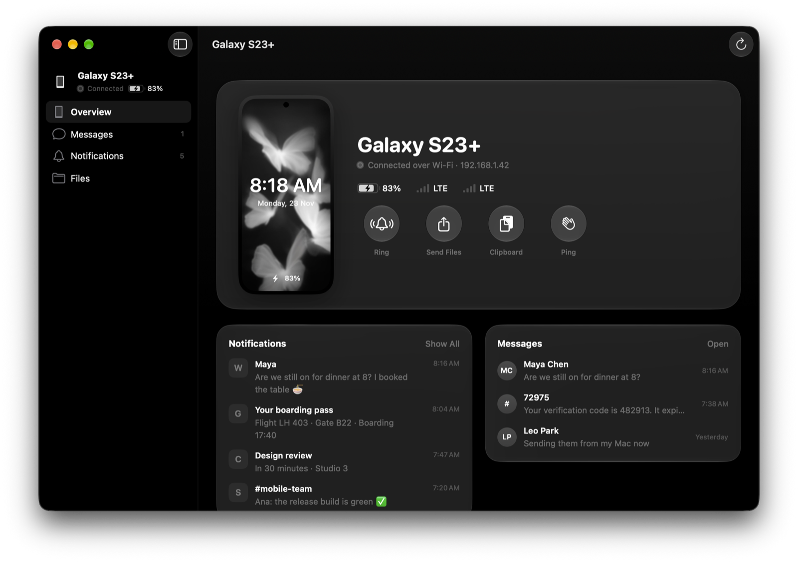
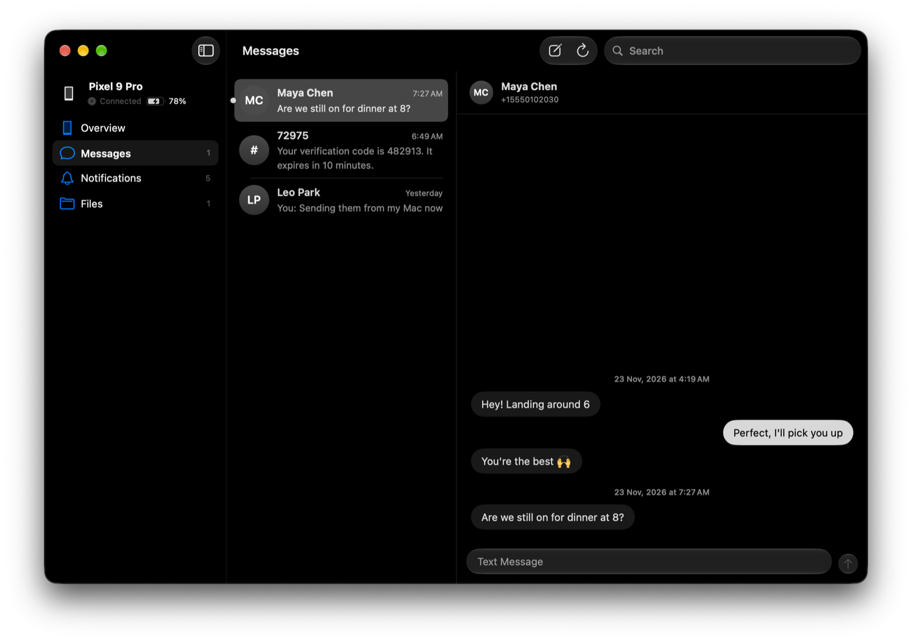
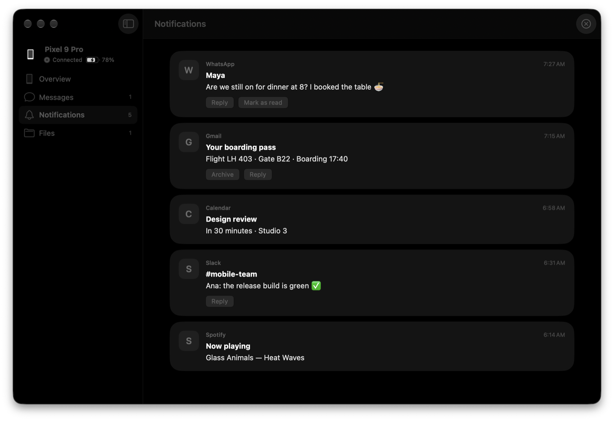

<p align="center">
  <picture>
    <source media="(prefers-color-scheme: dark)" srcset="assets/greeting-dark.gif">
    
  </picture>
</p>

<p align="center">
  <a href="https://github.com/atikulmunna/GlassLink/releases/latest"></a>
  
  <a href="LICENSE"></a>
</p>

GlassLink brings your Android phone to your Mac: notifications you can answer, your text messages,
incoming calls, your clipboard, your screenshots and your files, in a native macOS app with a
matching Android companion. It runs entirely on your own Wi-Fi, with no accounts and no cloud.

<p align="center">
  <a href="https://github.com/atikulmunna/GlassLink/releases/latest"><b>Download for Mac (.dmg)</b></a>
  &nbsp;·&nbsp;
  <a href="https://github.com/atikulmunna/GlassLink/releases/latest"><b>Download for Android (.apk)</b></a>
</p>

<p align="center">
  
  &nbsp;
  
</p>

## Why GlassLink

### What Phone Link gets right

Microsoft's **Phone Link** set the bar for using an Android phone from a computer. Notifications show
up on the desktop and you can reply to them. Your SMS conversations are a click away. Calls ring on
the computer. Recent photos and screenshots are right there, and copy-and-paste works across devices.
It feels like one system rather than two.

But Phone Link only exists on **Windows**. Apple's own Continuity features, like iPhone Mirroring
and Handoff, only work with an **iPhone**. If you use an Android phone with a Mac, none of that is
available to you.

### What KDE Connect is missing

[KDE Connect](https://kdeconnect.kde.org) is the excellent open-source answer to this problem, and
GlassLink is built on its protocol. On a Mac, though, it falls short of what Phone Link offers:

- **It isn't really a Mac app.** On macOS it runs as a cross-platform Qt application that doesn't
  look or behave like the rest of your Mac, and KDE describes the Mac build as experimental:
  there's no stable, signed release, only nightly builds.
- **Copy and paste is text only.** Images you copy on one device can't be pasted on the other.
- **Screenshots don't travel.** To get a screenshot from your phone to your Mac, you have to share
  it by hand or browse the phone's files.
- **Phone-to-computer copying needs a tap.** Since Android 10, apps in the background can't read
  the clipboard, so copied text has to be sent manually unless you set up a workaround.

### How GlassLink closes the gap

- **A native Mac app.** GlassLink for Mac is written in SwiftUI with macOS's Liquid Glass, and
  has a menu bar panel, Notification Center integration with inline replies, and drag-and-drop.
- **A companion app that adds what was missing.** GlassLink for Android is a fork of KDE Connect
  for Android with new features:
  - **Instant screenshots:** a screenshot taken on the phone is on the Mac's clipboard within about
    a second, with a floating thumbnail you can drag into any app. Screenshots from the Mac go onto
    the phone's clipboard.
  - **Image copy and paste in both directions**, plus **Get Phone's Clipboard** and
    **Get Mac's Clipboard** buttons when you want to pull rather than push.
  - **Automatic phone-to-Mac clipboard**, using a one-time permission (see
    [Optional: automatic copying from the phone](#optional-automatic-copying-from-the-phone)).
  - **Your phone, as it looks:** your home-screen wallpaper on the Mac, and your Mac on the phone.
- **Clutter-free by design.** Synced screenshots and images live on the clipboard only. Nothing is
  saved into your Pictures or Downloads unless you choose to save it.
- **Still compatible with KDE Connect.** GlassLink speaks the KDE Connect protocol (version 8).
  GlassLink for Mac also works with the stock KDE Connect Android app; you get the core features,
  and the extras appear when the phone runs GlassLink for Android.

### At a glance

| | Phone Link | KDE Connect on Mac | **GlassLink** |
|---|:---:|:---:|:---:|
| Runs on a Mac | — (Windows only) | Experimental (Qt) | **✓ native SwiftUI** |
| Notifications with reply | ✓ | ✓ | **✓** |
| Text messages (SMS) | ✓ | Partial | **✓** |
| Incoming call alerts | ✓ | ✓ | **✓** |
| Answer calls on the computer | ✓ | — | — |
| Text copy and paste | ✓ | ✓ | **✓** |
| Image copy and paste | ✓ (select phones) | — | **✓ both ways** |
| Phone screenshots on the computer | ✓ | — (manual) | **✓ instant, on the clipboard** |
| Send files | ✓ | ✓ | **✓ drag and drop** |
| Mirror phone apps | ✓ (select phones) | — | — |
| No account or cloud needed | — (Microsoft account) | ✓ | **✓** |
| Open source | — | ✓ | **✓** |

## Features

**On your Mac**

- **Notifications** with app icons, inline reply, actions and dismiss, mirrored to Notification
  Center.
- **Messages:** your SMS conversations with contact names, and replies sent from the Mac.
- **Calls:** an incoming-call banner with a button to silence the ringer, and missed-call alerts.
- **Clipboard:** text syncs both ways automatically, and images too with GlassLink for Android.
- **Screenshots:** phone screenshots go straight to the Mac clipboard, and Mac screenshots go to the
  phone's.
- **Files:** drag files onto the window to send them, or send a link to open on the phone.
- **Find your phone** by ringing it, and let the phone ring your Mac.
- **Battery and signal** at a glance, in the window and the menu bar.
- **Midnight and white:** one black-and-white design across both apps, following your system's
  dark or light mode.

**On your phone**

Everything KDE Connect for Android does (notification sync, SMS, media and file sharing, remote
input and more), plus the GlassLink extras above, Ring and Ping tiles, and a home screen that shows
your Mac.

## Screenshots

<p align="center">
  
  
</p>

## Install

### Mac

Requires **macOS 26 Tahoe** or later, on Apple silicon or Intel.

1. Download `GlassLink-<version>.dmg` from the [latest release](https://github.com/atikulmunna/GlassLink/releases/latest),
   open it, and drag **GlassLink** into **Applications**.
2. Open GlassLink. This build isn't notarized by Apple yet, so the first time macOS says it can't
   verify the developer. Click **Done**, then open **System Settings › Privacy & Security** and
   click **Open Anyway** next to GlassLink. You only do this once.
3. When GlassLink asks to find devices on your local network, click **Allow**. That's how it
   reaches your phone. Allow notifications too, if you want phone notifications in Notification
   Center.

### Android

Requires **Android 6.0** or later; Android 10 or later is recommended.

1. On the phone, download `GlassLink-<version>.apk` from the [latest release](https://github.com/atikulmunna/GlassLink/releases/latest)
   and open it. If Android asks, allow your browser or file manager to install apps.
2. If **KDE Connect** is installed, disable or uninstall it first. Both apps use the same network
   port, so only one can run at a time.
3. Open GlassLink, keep the phone on the same Wi-Fi as your Mac, and pair: pick your phone in
   GlassLink on the Mac, or tap your Mac in the phone app. Check that both screens show the same
   code, then accept.
4. Under **Finish setting up**, grant the permissions for the features you want, such as
   notification access, SMS, contacts and calls.

**Verify the download.** Release files are listed with their SHA-256 hashes in `SHA256SUMS`. The APK
is signed with the GlassLink release key, whose certificate SHA-256 fingerprint is:

```
18:8E:28:A2:8D:20:85:E6:29:B4:5E:64:B2:F3:63:CC:3D:04:D1:50:F9:24:5C:F9:01:83:AD:82:D4:C5:CA:03
```

You can check it with `apksigner verify --print-certs GlassLink-<version>.apk`.

### Optional: automatic copying from the phone

Android only lets the app that's on screen read the clipboard. To have text and images you copy on
the phone go to your Mac automatically, grant GlassLink one extra permission once, from a computer
with [Android platform tools](https://developer.android.com/tools/releases/platform-tools) and USB
debugging enabled on the phone:

```sh
adb shell pm grant io.github.atikulmunna.glasslink android.permission.READ_LOGS
adb shell appops set io.github.atikulmunna.glasslink SYSTEM_ALERT_WINDOW allow
adb shell am force-stop io.github.atikulmunna.glasslink
```

On Android 13 and later, the phone then asks "Allow GlassLink to access all device logs?" when
GlassLink starts, usually once after each restart of the phone. Tap **Allow one-time access**.

Without this, use **Send clipboard** on the phone, or **Get Phone's Clipboard** on the Mac.

## Privacy and security

- **Local only.** Your phone and Mac talk directly over your Wi-Fi. There are no accounts, no
  servers and no analytics.
- **Encrypted and pinned.** Every connection uses TLS. At pairing, each device remembers the
  other's certificate and refuses any device that later presents a different one. Access to the
  phone's files is authenticated with the same keys, and the phone's identity is checked.
- **You confirm each pairing** by comparing the code on both screens.
- **Nothing piles up.** Synced screenshots and images stay on the clipboard; received files go only
  where you send them.

## Repository layout

```
GlassLink/
├── macos/      GlassLink for Mac: Swift package (KDEConnectKit protocol library + SwiftUI app)
├── android/    GlassLink for Android: fork of KDE Connect for Android (kept mergeable with upstream)
├── tools/      make-icon.swift (both apps' icons), make-banner.swift (the animated README banner),
│               handshake.svg (Material Symbols, Apache 2.0)
├── scripts/    release.sh, package-macos.sh, package-android.sh
├── assets/     banner, icon, screenshots
├── VERSION     one version number for both apps
└── CHANGELOG.md
```

## Building from source

**Mac:** Xcode 26 or later.

```sh
cd macos
./build.sh run        # build build.noindex/GlassLink.app and open it
./test.sh             # protocol tests: TLS handshake, pairing code, payloads, certificate pinning
```

`GLASSLINK_TRACE=1` prints protocol traces to the terminal. `GLASSLINK_DEMO=1` shows a pretend
phone, which is handy for UI work. `GLASSLINK_SCREENSHOT=1` uses your real phone but shows sample
notifications and messages, for screenshots that don't reveal your own.

**Android:** JDK 21 and the Android SDK (platform 37).

```sh
cd android
./gradlew assembleDebug   # installs alongside a release build, as io.github.atikulmunna.glasslink.debug
```

**Artwork:** `swift tools/make-icon.swift` redraws the Mac and Android icons; `swift tools/make-banner.swift`
redraws the animated banner (install `gifsicle` to keep it small).

## Releasing

1. Update `VERSION` and add a section to `CHANGELOG.md`.
2. Run `scripts/release.sh --publish`. It builds `dist/GlassLink-<version>.dmg` (universal) and
   `dist/GlassLink-<version>.apk` (signed), writes `SHA256SUMS`, and creates the GitHub release.

The APK is signed with a release key kept outside the repository, in
`~/.glasslink/keystore.properties` (or the file named by `GLASSLINK_KEYSTORE_PROPERTIES`). Keep a
backup: Android only installs updates signed with the same key.

To ship a DMG that opens without the Open Anyway step, set `SIGN_IDENTITY` to a Developer ID
certificate and `NOTARY_PROFILE` to a notarytool profile; `scripts/package-macos.sh` explains how.

## Roadmap

- Notarized DMG
- Media controls for music playing on the phone
- A gallery of recent photos
- Discovery on networks that block broadcasts (mDNS)

## Credits and license

GlassLink stands on the work of the [KDE Connect](https://kdeconnect.kde.org) team. Its protocol
makes this possible, and GlassLink for Android is a fork of
[KDE Connect for Android](https://invent.kde.org/network/kdeconnect-android). The Mac app is built
with [SwiftNIO](https://github.com/apple/swift-nio), [SwiftNIO SSL](https://github.com/apple/swift-nio-ssl),
[Swift Certificates](https://github.com/apple/swift-certificates) and
[Swift Crypto](https://github.com/apple/swift-crypto).

GlassLink is free software under the [GNU General Public License v3.0](LICENSE). Files in `android/`
keep their upstream license headers (GPL-2.0-only or GPL-3.0-only).

The Android robot in the banner is reproduced or modified from work created and shared by Google
and used according to terms described in the
[Creative Commons 3.0 Attribution License](https://creativecommons.org/licenses/by/3.0/). The
handshake is the "handshake" icon from [Material Symbols](https://github.com/google/material-design-icons)
(Apache License 2.0).

GlassLink is an independent project, not affiliated with or endorsed by KDE e.V., Google, Microsoft
or Apple. Android is a trademark of Google LLC; Phone Link is a trademark of Microsoft; Mac, macOS,
iPhone and Continuity are trademarks of Apple.
